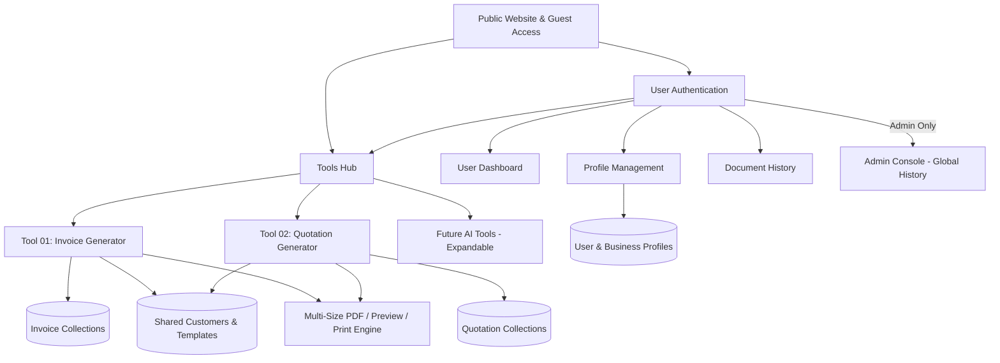

# SmartTools Platform — MERN Modular Monolith Masterplan

> **Repository:** `https://github.com/Nisal-A/Invoice-Qoutation-Generator.git`  
> **Architecture:** Modular Monolithic MERN Application  
> **Database:** MongoDB (`smart_tools_db`) with strict logical collection separation  
> **Core Principle:** One platform, multiple independent tools, one centralized user system, guest-ready document generation, and strict role-based data isolation.

---

## 1. Platform Overview & Application Structure

SmartTools is a centralized multi-tool web platform hosting **Invoice Generator** and **Quotation Generator** as completely independent tools accessible from a central **Tools Hub**, backed by a separate **Profile Management** section, unified **Document History**, **Dashboard**, and an **Admin Governance Console**.



### Main Application Sections
- **Public Landing & Guest Workspace (`/`):** Clean entry hero with zero-signup quick-launch CTAs ("Create Free Invoice", "Create Free Quotation", "Explore All Tools"), allowing unauthenticated visitors to launch tools immediately without creating an account.
- **Dashboard (Authenticated):** Activity summary, KPIs (total invoiced, pending payments, active quotes, conversion rate), recent documents, and quick tool launch.
- **Tools Hub (Guest + Authenticated, `/tools`):** Central searchable catalog powered by `frontend/src/config/toolsRegistry.js` with category tabs, Guest Friendly / Pinned Only filter pills, star pin/unpin controls, and separated Available Tools vs. Upcoming Tools Roadmap sections.
- **Profile Management (Authenticated — Separate Section):** Personal details, reusable business profile, logo upload, bank details, tax preferences, default currency, payment terms, default document paper sizes, and security settings.
- **Document History (Authenticated):** Unified, filterable history of the logged-in user's own invoices and quotations.
- **Admin Console (Admin Only):** Cross-user global document history, user role management, and admin access audit logs.

### Scalable Tools Registry & Navigation Architecture
To support dozens of future tools without cluttering the header or sidebar, every navigation surface reads from a single configuration source (`frontend/src/config/toolsRegistry.js`):
- **Registry Schema:** Exports `TOOL_CATEGORIES` (`finance`, `documents`, `ai`, `utilities`), `TOOLS_REGISTRY[]` (`id`, `name`, `shortName`, `tagline`, `description`, `route`, `iconName`, `category`, `tags[]`, `supportsGuestMode`, `status`, `featured`, `defaultPinned`, `accentColor`, `highlights[]`), and helpers (`getActiveTools`, `getToolsByCategory`, `searchTools`, `getToolByRoute`).
- **Adding a New Tool:** Requires **only** appending one object to `toolsRegistry.js` and registering its lazy route component in `TOOL_PAGE_COMPONENTS` (`Router.jsx`). It automatically appears in the Tools Hub, Category filters, Tools Mega-Menu, Quick-Create menu, Breadcrumbs, and `Ctrl+K` / `Cmd+K` Command Switcher with zero edits to navigation components. Upcoming (`coming_soon`) tools safely render `ToolPreviewPage` instead of broken routes.
- **Dual-Mode Shell Navigation:**
  - **Top Navbar (`TopNavbar.jsx`):** Shared across Guest and Authenticated shells with dynamic breadcrumbs, a global `Ctrl+K` / `Cmd+K` `CommandToolSwitcher.jsx` modal (recent tools, categorized search, quick actions), and mode-aware controls (`ToolsMegaMenu.jsx` + Guest Mode pill + Auth CTAs for guests; Quick-Create `+` menu + Notifications + User Avatar dropdown for authenticated users).
  - **Collapsible Sidebar (`SidebarNav.jsx` — Auth only):** Organizes links into 4 bounded groups—**Core** (`Dashboard`, `All Tools`, `Document History`), **Pinned Tools** (max 5 user-customizable slots synced via `/api/v1/auth/me/pinned-tools` or `localStorage`), **Workspace** (`Profile Management`, `Customers`), and **Admin** (rendered strictly for `role === 'admin'`). Supports desktop collapsed icon-rail mode and mobile slide-over drawer.
  - **Guest Shell (`GuestShellLayout.jsx`):** Full-width workspace below `TopNavbar` with no empty auth sidebar so guests get maximum room for split-screen document editors.

---

## 2. Access Control & Guest Mode Architecture

| Capability | Guest (No Account) | Standard User (`role: 'user'`) | Admin (`role: 'admin'`) |
| :--- | :--- | :--- | :--- |
| **Invoice & Quotation Creation** | Full access (manual business & client details) | Full access (auto-filled Business Profile & Customer picker) | Full access |
| **Multi-Size Preview, Print & PDF Download** | Full access (stateless rate-limited PDF API) | Full access (saved + server PDF export) | Full access |
| **Draft Persistence** | Browser `localStorage` auto-save | Cloud database (`smart_tools_db`) | Cloud database |
| **Quotation to Invoice Conversion** | Client-side draft handoff | 1-click transactional DB conversion | 1-click transactional DB conversion |
| **Profile & Customer Directory** | Unavailable | Full CRUD on own profile & customers | Full CRUD on own + user moderation |
| **Document History** | Unavailable (prompted to sign up) | **Strictly own records** (`userId === req.user.id`) | **Global visibility** across all users |

### Guest-to-Cloud Seamless Migration Flow
1. Guests open `/tools/invoice-generator` or `/tools/quotation-generator` directly with no login barrier.
2. Form state auto-saves locally under `smarttools_guest_invoice_draft` or `smarttools_guest_quote_draft`.
3. Clicking **Download PDF** calls the stateless public endpoint `POST /api/v1/public/pdf/render`, returning a PDF stream without writing to MongoDB.
4. Clicking **Save to Cloud** opens an inline auth modal; upon login/registration, the app automatically submits the `localStorage` draft to `/api/v1/invoices` or `/api/v1/quotations`, clears local cache, and redirects to the saved record.

### Strict History Isolation Rules
- Standard user endpoints (`GET /api/v1/history`, `/api/v1/invoices/*`, `/api/v1/quotations/*`) **always hardcode `userId = req.user.id`** in the service layer and ignore any `userId` sent in query strings or request bodies.
- Accessing an unauthorized document ID as a standard user returns `404 Not Found` to prevent ID enumeration.
- Only `role === 'admin'` users can access `/api/v1/admin/history`, and every cross-user history view or document inspection automatically writes an immutable record to `admin_audit_logs`.

---

## 3. Multi-Size Document & PDF Standards

Invoices and Quotations adapt typography, margins, table column density, and footer layout per physical paper standard—never simple CSS zoom shrinking.

| Size Code | Physical Dimensions | Supported Tools | Layout Adaptation Rules |
| :--- | :--- | :--- | :--- |
| **`A4`** *(Default)* | 210 × 297 mm | Invoice, Quotation | 15mm margins, 2-column header, 6-column item table, side-by-side Bank Details + Totals |
| **`A5`** | 148 × 210 mm | Invoice, Quotation | 10mm margins, 9pt base font, compact 4-column table (merged Qty × Rate), stacked footer |
| **`LETTER`** | 215.9 × 279.4 mm (8.5 × 11 in) | Invoice, Quotation | 15mm margins, North American standard grid equivalent to A4 with adjusted page break |
| **`LEGAL`** | 215.9 × 355.6 mm (8.5 × 14 in) | Quotation, Invoice | Extended vertical item capacity + dedicated multi-paragraph Terms & Acceptance Signature block |
| **`B5`** | 176 × 250 mm | Invoice, Quotation | 12mm margins, 9.5pt typography, condensed column widths |
| **`THERMAL_80`** | 80 mm × Auto Roll Height | Invoice *(POS/Receipt)* | Single-column flow, 4mm side padding, monospace totals, dynamic height via `scrollHeight` |

- **Orientation:** `portrait` (default) and `landscape` supported for `A4`, `A5`, `LETTER`, and `B5`.
- **Preview-to-PDF Parity:** Both the React `DocumentPaperCanvas` and the backend Puppeteer engine consume `shared/constants/paperSizes.js` and shared print CSS rules (`@page`, `thead { display: table-header-group; }`, `break-inside: avoid`).
- **Puppeteer Hardening:** Single warm Chromium instance with isolated `BrowserContext` per job, max concurrency queue (3), external request interception blocking non-whitelisted hosts (SSRF protection), strict HTML escaping, and IP rate limiting on guest renders.

---

## 4. Feature Specifications

### A. Invoice Generator (Tool 01 — Independent)
- Auto-retrieves saved Business Profile (with per-document local override) or manual entry in Guest Mode.
- Add or select customers from Shared Customers directory.
- Dynamic products/services line-item table with automatic subtotal, per-item/global discount, tax, grand total, and balance due calculations.
- Atomic auto-incrementing invoice number generation (`INV-YYYY-XXXX`).
- Invoice date, due date, payment terms, and bank account details.
- Multi-size selector (`A4`, `A5`, `LETTER`, `LEGAL`, `B5`, `THERMAL_80`) + Portrait/Landscape toggle + theme accents (`Indigo`, `Emerald`, `Slate`).
- Save as draft, edit, duplicate, record partial/full payments, track payment status (`draft`, `sent`, `partial`, `paid`, `overdue`, `void`).
- Live scaled paper preview, clean `@media print`, and Puppeteer PDF download.

### B. Quotation Generator (Tool 02 — Independent)
- Separate document workflow and collections from Invoices.
- Auto-retrieves saved Business Profile or supports manual Guest Mode entry.
- Add or select shared customers; dynamic products/services table and financial calculations.
- Atomic quotation numbering (`QUO-YYYY-XXXX`), issue date, validity period (`validUntil` with quick presets), delivery terms, payment terms, and client acceptance signature block.
- Standard quotation sizes (`A4`, `A5`, `LETTER`, `LEGAL`, `B5`) + Portrait/Landscape toggle.
- Save, edit, duplicate, status tracking (`draft`, `sent`, `accepted`, `rejected`, `expired`, `converted`).
- **Convert Accepted Quotation to Invoice:** Atomic MongoDB transaction linking `sourceQuotationId` and `convertedInvoiceId` for logged-in users; local draft handoff for guests.

### C. Profile Management (Separate Section)
- Personal info (`user_profiles`), Business info (`business_profiles`), Cloudinary logo upload (`file_metadata`).
- Contact info, address, business/tax registration details, bank account details.
- Reusable defaults: default currency, default tax rate, default payment terms, default invoice size, default quotation size.
- Shared Customer Directory CRUD and account security settings.

---

## 5. Database Architecture (`smart_tools_db`)

One MongoDB database with strictly separated collections. Every user-owned document carries an indexed `userId`.

| Domain | Collection | Key Fields & Rules | Primary Indexes |
| :--- | :--- | :--- | :--- |
| **User Management** | `users` | `email`, `passwordHash`, `role` (`'user' \| 'admin'`), `isActive`, `refreshTokenHash`, `lastLoginAt` | `{ email: 1 }` (unique), `{ role: 1 }` |
| **User Management** | `user_profiles` | `userId`, `fullName`, `phone`, `avatarUrl`, `timezone`, `locale` | `{ userId: 1 }` (unique) |
| **User Management** | `business_profiles` | `userId`, `businessName`, `logoFileId`, `taxRegistrationNo`, `email`, `phone`, `address{}`, `bankDetails{}`, `defaultCurrency`, `defaultTaxRate`, `defaultPaymentTerms`, `defaultInvoiceSize`, `defaultQuotationSize` | `{ userId: 1 }` (unique) |
| **Invoice Generator** | `invoices` | `userId`, `customerId`, `invoiceNumber`, `issueDate`, `dueDate`, `currency`, `status`, `pageSize`, `orientation`, `templateKey`, `businessSnapshot{}`, `customerSnapshot{}`, `subtotal`, `discount{}`, `taxTotal`, `grandTotal`, `amountPaid`, `balanceDue`, `paymentTerms`, `notes`, `sourceQuotationId` | `{ userId: 1, createdAt: -1 }`, `{ userId: 1, invoiceNumber: 1 }` (unique), `{ status: 1 }` |
| **Invoice Generator** | `invoice_items` | `userId`, `invoiceId`, `sortOrder`, `name`, `description`, `quantity`, `unit`, `unitPrice`, `taxRate`, `discount`, `lineTotal` | `{ invoiceId: 1, sortOrder: 1 }`, `{ userId: 1 }` |
| **Invoice Generator** | `invoice_payments` | `userId`, `invoiceId`, `amount`, `paymentDate`, `method`, `referenceNo`, `notes` | `{ invoiceId: 1 }`, `{ userId: 1 }` |
| **Quotation Generator** | `quotations` | `userId`, `customerId`, `quotationNumber`, `issueDate`, `validUntil`, `currency`, `status`, `pageSize`, `orientation`, `templateKey`, `businessSnapshot{}`, `customerSnapshot{}`, `subtotal`, `discount{}`, `taxTotal`, `grandTotal`, `deliveryTerms`, `paymentTerms`, `notes`, `convertedInvoiceId` | `{ userId: 1, createdAt: -1 }`, `{ userId: 1, quotationNumber: 1 }` (unique), `{ status: 1 }` |
| **Quotation Generator** | `quotation_items` | `userId`, `quotationId`, `sortOrder`, `name`, `description`, `quantity`, `unit`, `unitPrice`, `taxRate`, `discount`, `lineTotal` | `{ quotationId: 1, sortOrder: 1 }`, `{ userId: 1 }` |
| **Shared Resources** | `customers` | `userId`, `name`, `companyName`, `email`, `phone`, `billingAddress{}`, `shippingAddress{}`, `taxId`, `notes` | `{ userId: 1, name: 1 }`, `{ userId: 1, email: 1 }` |
| **Shared Resources** | `document_templates` | `key`, `toolType`, `name`, `accentColor`, `supportedSizes[]`, `isSystemDefault` | `{ toolType: 1, key: 1 }` |
| **Shared Resources** | `file_metadata` | `userId`, `cloudinaryPublicId`, `secureUrl`, `mimeType`, `bytes`, `entityType` | `{ userId: 1, entityType: 1 }` |
| **Shared Resources** | `counters` | `userId`, `sequenceType` (`'invoice' \| 'quotation'`), `prefix`, `year`, `seq` | `{ userId: 1, sequenceType: 1, year: 1 }` (unique) |
| **Admin Governance** | `admin_audit_logs` | `adminUserId`, `action`, `targetUserId`, `resourceType`, `resourceId`, `ipAddress`, `timestamp` | `{ adminUserId: 1, timestamp: -1 }`, `{ targetUserId: 1 }` |
| **Future AI Tools** | *Dedicated collections* | Added per tool with `userId` + History adapter without modifying existing schemas | `{ userId: 1, createdAt: -1 }` |

> **Immutability Rule:** Saved invoices and quotations embed `businessSnapshot` and `customerSnapshot` at write time so future profile or customer updates never alter historical financial records.

---

## 6. Technology Stack

| Layer | Technology | Responsibility |
| :--- | :--- | :--- |
| **Frontend** | React.js + Vite | SPA pages and modular tool interfaces |
| **Styling** | Tailwind CSS + Lucide React | Responsive UI & print-safe paper layouts |
| **Routing & Forms** | React Router v6, React Hook Form, Zod | Navigation, route guards, form state & shared validation |
| **Backend** | Node.js + Express.js | Modular REST API (`/api/v1`) |
| **Database** | MongoDB + Mongoose | Central database (`smart_tools_db`) & schema models |
| **Auth & Security** | JWT (15m Access) + HttpOnly Refresh Cookie (7d), Bcrypt, Helmet, Rate Limiter | Stateless auth, RBAC, and guest abuse prevention |
| **PDF Engine** | Puppeteer (Warm Browser Pool) | Multi-size server-side PDF rendering |
| **File Storage** | Cloudinary + Multer | Business logo & file metadata storage |

---

## 7. Modular Monolith Folder Structure

```text
Invoice-Qoutation-Generator/
├── MASTERPLAN.md
├── shared/
│   ├── constants/paperSizes.js          # Single source of truth for A4, A5, Letter, Legal, B5, Thermal 80mm
│   ├── schemas/                         # Shared Zod schemas (invoice, quotation, customer, profile, paperConfig)
│   └── utils/financialMath.js           # Deterministic subtotal, discount, tax, total & balance engine
│
├── frontend/
│   ├── .env.example
│   └── src/
│       ├── app/                         # Router, AuthContext, AuthModal, RouteGuards
│       ├── config/toolsRegistry.js      # Dynamic registry for Tools Hub & Sidebar
│       ├── layouts/                     # GuestShellLayout, AppShellLayout, AdminLayout
│       ├── pages/
│       │   ├── Landing/
│       │   ├── Auth/
│       │   ├── Dashboard/
│       │   ├── Tools/
│       │   ├── InvoiceGenerator/
│       │   ├── QuotationGenerator/
│       │   ├── ProfileManagement/
│       │   ├── DocumentHistory/
│       │   └── Admin/                   # GlobalHistory, UserManagement, AuditLogs
│       ├── components/
│       │   ├── shared/                  # DocumentPaperCanvas, PaperSizeSelector, LineItemsTable,
│       │   │                            # CustomerPickerModal, GuestModeBanner, DocumentExportBar
│       │   ├── invoice/                 # PaymentRecorderModal, InvoiceStatusBadge
│       │   └── quotation/               # ConvertToInvoiceModal, ValidityBadge
│       └── services/                    # Axios client + module API services + guest localStorage service
│
└── backend/
    ├── .env.example
    └── src/
        ├── config/                      # db.js, cloudinary.js, env.js, puppeteerPool.js
        ├── middleware/                  # auth, role, ownership, validate, rateLimit, errorHandler
        ├── scripts/seedAdmin.js         # Idempotent initial Admin bootstrap
        ├── modules/
        │   ├── authentication/
        │   ├── users/
        │   ├── profiles/
        │   ├── customers/
        │   ├── invoices/
        │   ├── quotations/
        │   ├── documents/               # Unified User History aggregator & saved PDF streaming
        │   ├── pdf-engine/              # Multi-size HTML templates + Guest stateless PDF endpoint
        │   └── admin/                   # Global cross-user history, user management, audit logs
        └── utils/                       # AppError, asyncHandler, counterService, htmlSanitizer
```

---

## 8. REST API Surface (`/api/v1`)

| Module | Endpoints | Access | Notes |
| :--- | :--- | :--- | :--- |
| **Health** | `GET /health` | Public | Server & MongoDB readiness check |
| **Auth** | `POST /auth/register`, `/login`, `/refresh`, `/logout`, `GET /auth/me` | Public / Auth | Access JWT + HttpOnly refresh cookie |
| **Profiles** | `GET /profiles/me`, `PUT /profiles/personal`, `PUT /profiles/business`, `POST /profiles/business/logo` | `requireAuth` | Own profile & reusable defaults |
| **Customers** | `GET /customers`, `POST /customers`, `GET/PUT/DELETE /customers/:id` | `requireAuth` | Shared customer directory (own only) |
| **Invoices** | `GET/POST /invoices`, `GET/PUT/DELETE /invoices/:id`, `POST /invoices/:id/duplicate`, `POST /invoices/:id/payments` | `requireAuth` | Strictly `userId === req.user.id`; server-computed math |
| **Quotations** | `GET/POST /quotations`, `GET/PUT/DELETE /quotations/:id`, `POST /quotations/:id/duplicate`, `POST /quotations/:id/convert-to-invoice` | `requireAuth` | Strictly `userId === req.user.id`; transactional conversion |
| **PDF (Guest)** | `POST /public/pdf/render` | **Public (Rate-Limited)** | Stateless multi-size PDF render; no DB write |
| **History & PDF (User)** | `GET /history`, `GET /documents/:type/:id/pdf?size=&orientation=` | `requireAuth` | Strictly own records (Admin permitted on `/documents/:type/:id/pdf` with audit log) |
| **Admin** | `GET /admin/history`, `GET /admin/history/:type/:id`, `GET /admin/users`, `PATCH /admin/users/:id/role`, `GET /admin/audit-logs` | `requireAdmin` | Global cross-user visibility; every inspection logged |

---

## 9. Phase Progress Tracker

- [x] **Part 1:** Repository Audit, `MASTERPLAN.md`, Monolith Scaffold & `shared/` Package (`paperSizes.js`, `financialMath.js`, Zod schemas)
- [x] **Part 2:** Backend Core — MongoDB (`smart_tools_db`), JWT Auth, RBAC, Admin Seed, Profile Management & Shared Customers
- [x] **Part 3:** Multi-Size Puppeteer PDF Engine (`A4`, `A5`, `LETTER`, `LEGAL`, `B5`, `THERMAL_80`) & Stateless Guest PDF API
- [x] **Part 4:** Backend Tool Modules — Invoices, Quotations (+ Convert to Invoice), Unified User History & Admin Governance
- [x] **Part 5:** Frontend Shell — Dual Guest/Auth Layouts, Tools Hub, Auth Modal, Profile Management & Customers Directory
- [x] **Part 6:** Frontend Generators — Multi-Size Adaptive Canvas, Invoice Generator & Quotation Generator (Guest Mode + Cloud Sync)
- [x] **Part 7:** User Dashboard, Scoped Document History, Admin Console (Global History + Audit Logs) & Final Security QA
